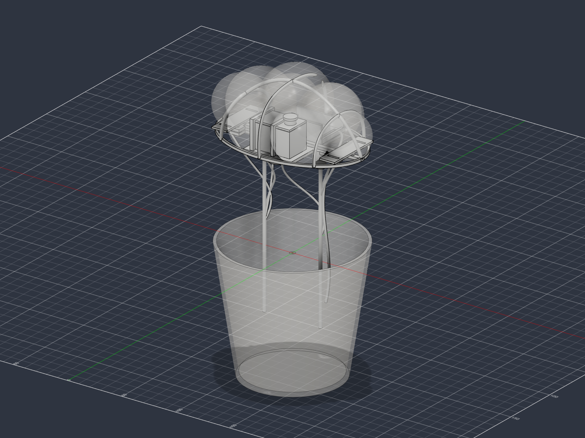

# cloud_bot

cloud_bot 是一款桌面陪伴原型：用一朵云表达天气状态，并逐步连接摄像头、灯光、雾化和植物滴灌。

当前版本聚焦于可验证的第一步：只使用现有 ESP32-CAM、MB 底座和 USB 数据线，运行本地 Wi‑Fi 网页，手动切换晴天/阴天/雨天并按需查看摄像头画面；另提供一个独立的 12V WS2811 类灯带台架测试程序。

## 当前状态

- 已完成：硬件盘点与边界说明、现有零件启动指南、ESP32-CAM 网页原型代码、灯带独立测试代码、上传脚本。
- 已有实验代码：`emotion_control.py` + `EMOTION-CONTROL-README.md` 提供电脑摄像头的本地表情线索联动，支持可调置信度阈值。
- 已完成 V7 概念建模：双插杆、可拆云骨架、水箱、灯带托架和摄像头托盘；现有报告记录 20 个组件、279 项建模历史。
- 待验证：Arduino 编译/烧录、实体灯带通电、雾化、滴灌、结构打样、防漏与稳定性；外罩和部分硬件仍为占位包络。
- 未完成：实物制造及完整硬件联调，当前 CAD 不能直接视为生产图。
- 安全边界：12V 灯带不能接开发板供电；水路和大电流负载必须独立供电并具备默认关闭、限时与缺水保护。

## 目录

- `START-HERE-existing-parts.md`：只用现有零件启动网页原型。
- `cloud_bot-prototype-plan.md`：整体目标、阶段计划、验收条件与风险边界。
- `light-test-wiring.md`：12V 灯带与 AHCT125 电平转换的独立测试接线。
- `firmware/cloud_bot_existing_parts/`：ESP32-CAM 网页天气/摄像头原型。
- `firmware/cloud_bot_light_test/`：仅控制灯带的 FastLED 台架测试。
- `tools/upload-cloud-bot.ps1`：编译并上传现有零件版本。
- `emotion_control.py`：本地摄像头联动实验（需 OpenCV、requests 及所选识别引擎）。
- `design/`：V1–V7 概念图、Fusion 建模脚本及 V7 模型导出。

## V7 建模进度（2026-11-12）

- [Fusion 原生模型](design/v7-cad/CloudBot-V7.f3d)：用于编辑组件、草图与建模历史。
- [STEP 交换模型](design/v7-cad/CloudBot-V7.step)：用于跨 CAD 软件查看与交换。
- [结构说明与下一轮验证](design/v7-cad/README-中文.md)、[内部结构图](design/v7-cad/v7-internals.png)。
- [Fusion 生成脚本](design/fusion/CloudBotV7/CloudBotV7.py)、[现有检查报告](design/v7-cad/validation.json)。

当前设计为约 140 mm 宽的云外观、两根直径 3 mm 插杆和约 10 mL 工作容量的水箱。最终检查报告在所列结构件与硬件占位件范围内记录的干涉为空；该检查排除了装饰枝、电源线、外罩及参考花盆，也不代表防漏、强度或实物适配验证。本次上传核对了现有文件和报告，未重新运行 Fusion 或硬件测试。

## 快速开始

1. 安装 Arduino IDE、Espressif Arduino-ESP32 3.x，并选择 AI Thinker ESP32-CAM。
2. 按 [`START-HERE-existing-parts.md`](START-HERE-existing-parts.md) 连接 USB、上传并访问 `http://192.168.4.1`。
3. 灯带测试必须先读完 [`light-test-wiring.md`](light-test-wiring.md)，确认 12V 电源、共地和电平转换后再通电。

程序默认创建 Wi‑Fi 热点 `cloud_bot`，密码为 `set-a-local-password`。所有照片只在本地设备与浏览器之间传输，程序不保存或上传照片。

## 开发约定

每次硬件实测都应记录日期、板型/模块、供电条件、接线变更、现象和结论。未实测的参数保持“待确认”，不要直接升级为采购或验收结论。提交前至少检查文档与代码是否仍然一致。

## 许可证

本项目采用 MIT License，见 [`LICENSE`](LICENSE)。硬件、电源和水路操作请遵守模块厂商说明，并在断电后接线。

