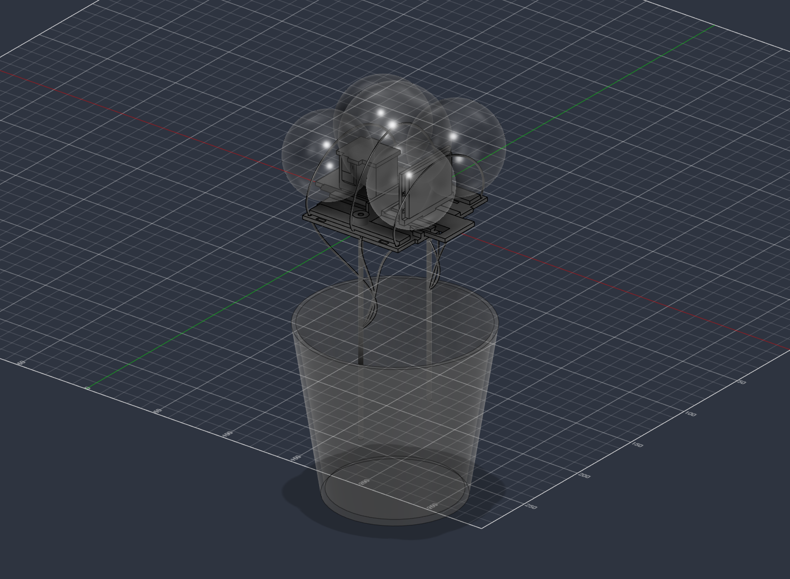

# cloud_bot

cloud_bot is a desktop companion prototype: a cloud-shaped object expresses weather states, with camera, lighting, misting, and plant drip irrigation being integrated in stages.

Software v2 provides manual weather switching and camera previews through a local ESP32-CAM web page. It can also receive weather suggestions from facial-expression recognition running on a computer webcam. The repository includes a separate bench-test program for a 12V WS2811-type LED strip.

## Current status

- Completed: hardware inventory and limitations, a getting-started guide for existing parts, ESP32-CAM web prototype code, standalone LED-strip test code, and upload scripts.
- Expression control v2 runs on the computer using ONNX Runtime, with an independent smile threshold and a stability hold time. The ESP32 switches between manual and automatic modes and returns to cloudy when the automatic signal stops. See the [setup guide](EMOTION-CONTROL-README.md).
- V7 concept modeling is complete: dual support rods, a removable cloud frame, water tank, LED-strip bracket, and camera tray. Existing reports record 20 components and 279 modeling-history entries.
- ESP32-CAM compilation, flashing, web endpoints, and camera capture have been documented. Real-person expression triggers, physical LED-strip integration, misting, and drip irrigation remain pending validation. See the [software validation record](SOFTWARE-VALIDATION.md).
- V7 has completed its first dry print and trial fit. V8 and V8.1 Fusion models and printable parts have been exported; full dry assembly, support removal, structural stability, and sealing still require physical testing.
- Safety boundaries: do not power a 12V LED strip from the development board. Water systems and high-current loads require independent power, default-off behavior, runtime limits, and low-water protection.

## Repository guide

- `START-HERE-existing-parts.md`: start the web prototype using only the parts already available.
- `cloud_bot-prototype-plan.md`: overall goals, staged plan, acceptance criteria, and risk boundaries.
- `light-test-wiring.md`: standalone wiring for a 12V LED strip and AHCT125 level shifting.
- `firmware/cloud_bot_existing_parts/`: ESP32-CAM weather/camera web prototype.
- `firmware/cloud_bot_light_test/`: LED-strip-only FastLED bench test.
- `tools/upload-cloud-bot.ps1`: compile and upload the existing-parts version.
- `emotion_control.py`: local webcam interaction experiment (requires OpenCV, requests, and the selected recognition engine).
- `design/`: concept images, Fusion modeling scripts, print files, and trial-fit records.

## V8.1 dry-fit version

- [V8.1 printing and trial fit](design/v8-1-cad/打印与试装.md), [Fusion model](design/v8-1-cad/CloudBot-V8.1.f3d), and [full-plate STL](design/v8-1-cad/CloudBot-V8.1-dry-plate.stl). V8.1 updates the tank and dual-latch lid on V8's integrated sliding-rail base.
- The [V8 assembly guide](design/v8-cad/组装与打印.md) retains the instructions for the rails, LED-strip support plate, rods, and camera tray.

## V7 modeling progress (2026-11-12)

- [Native Fusion model](design/v7-cad/CloudBot-V7.f3d): edit components, sketches, and modeling history.
- [STEP exchange model](design/v7-cad/CloudBot-V7.step): view and exchange the design across CAD software.
- [Structure and next validation steps](design/v7-cad/README-中文.md), [internal layout](design/v7-cad/v7-internals.png).
- [Fusion generation script](design/fusion/CloudBotV7/CloudBotV7.py), [existing validation report](design/v7-cad/validation.json).
- [First-print STLs, photographs, and trial-fit record](design/v7-cad/README-中文.md#第一版实物试打记录): original individual-part and full-plate files, physical photographs, assembly issues, and the next trial-fit plan.

The current design has a cloud approximately 140 mm wide, two 3 mm-diameter support rods, and a tank with an approximately 10 mL working capacity. The final report records no interference within its listed structural parts and hardware placeholders. It excludes decorative branches, power cables, the outer covering, and the reference flowerpot, and does not establish leak resistance, strength, or physical fit. The publication checked existing files and reports; Fusion and hardware tests were not rerun.

## Quick start

1. Install Arduino IDE and Espressif Arduino-ESP32 3.x, then select AI Thinker ESP32-CAM.
2. Follow [`START-HERE-existing-parts.md`](START-HERE-existing-parts.md) to connect USB, upload, and visit `http://192.168.4.1`.
3. Before testing the strip, read [`light-test-wiring.md`](light-test-wiring.md) in full and confirm the 12V supply, common ground, and level shifting before applying power.

By default, the program creates the `cloud_bot` Wi-Fi hotspot with password `set-a-local-password`. Photos are transferred only between local devices and the browser; the program does not store them or upload them to a remote service.

## Development conventions

For every physical hardware test, record the date, board/module, power conditions, wiring changes, observations, and conclusions. Keep untested parameters marked as pending confirmation; do not turn them into purchasing or acceptance conclusions. Before committing, at minimum check that documentation and code remain consistent.

## License

This project uses the MIT License; see [`LICENSE`](LICENSE). Follow module manufacturers' instructions for hardware, power, and water systems, and disconnect power before wiring.
