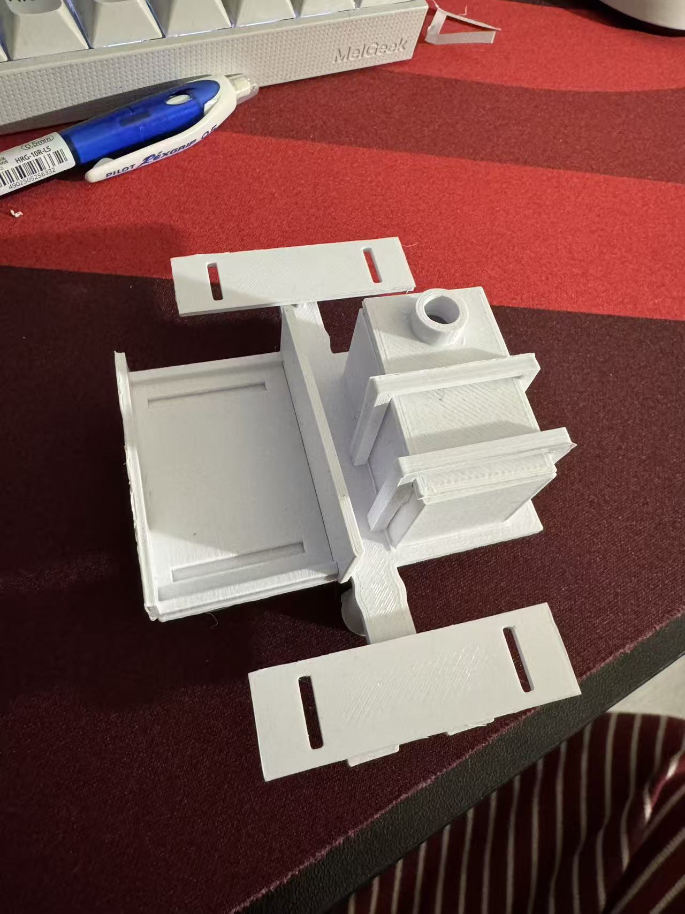

# Cloud Bot V7: Dual-Stake Concept Assembly

This is an editable spatial and structural prototype, not a validated production design ready for water use.

## Dimensions and Layout

- Target cloud width: approximately 140 mm, with a 130 × 86 mm elliptical frame. The flexible cover is represented by a separate spherical envelope, not a solid printable part.
- Reference flowerpot: 120 mm outer diameter and 110 mm tall. Soil level is Z=0; the rim is Z=10. The flowerpot is not a part to manufacture.
- Two load-bearing stakes: 3 mm diameter, 145 mm long, 52 mm center spacing; reference insertion depth into soil is 55 mm. The silver decorative branches are separate editable swept curves.
- Chassis underside: Z=90 mm. The tank sits at the front inside the cloud, and the control-board tray at the rear, with a splash barrier between them.
- Tank exterior: 36 × 22 × 22 mm; internal cavity approximately 11.9 mL. A provisional 10 mL working capacity leaves headroom. Runtime depends on the final atomizer's measured flow rate and duty cycle.
- Atomizer placeholder: 16 mm diameter and 2 mm thick. This only reserves space; do not use it as a purchasing specification or proof of fit.
- ESP32-CAM placeholder: a simplified 40 × 27 × 10 mm shape, upright with the lens facing forward. It does not include all pins, power connectors, or wiring. Cover openings must be refined against the actual hardware in the next iteration.
- Left and right LED-strip supports: 14 × 50 mm each. Measure the strip's actual cut-segment length; do not arbitrarily cut it to 50 mm.

## Opening and Editing

Open `CloudBot-V7.f3d` in Fusion. The native file contains components grouped by part, plus sketch, extrusion, cut, and sweep history.

Toggle `90 Cloud soft cover ENVELOPE` to switch between the external envelope and internal structure; `91 Flowerpot reference` controls the reference flowerpot.

Edit profiles in sketches and extrusions, planes, and sweeps in the timeline. User parameters currently document dimensions but do not drive every coordinate. To change the overall layout, modify `../fusion/CloudBotV7/CloudBotV7.py` and generate a new document. Do not assume that changing cloud_width scales the entire assembly.

`CloudBot-V7.step` is for exchange between CAD applications; it does not preserve the original sketches or modeling history. The soft cover and reference flowerpot are also solid envelopes, not parts to print. The first print uses individual or plate-layout STL files; the plate contains 9 separate fit-test parts.

## Assembly Plan

1. Insert the two stainless-steel stakes into the sockets beneath the chassis. The 0.4 mm diametral clearance is an initial setting; the locking method requires prototyping.
2. Align the cloud frame with the chassis using the four M2 through-holes. Select screws and nuts for the actual printed-part thickness.
3. The LED-strip supports' short central feet rest on the cloud frame's crossbeam. V7 has no fastening feature for these feet. The slots at the ends secure the strips. Measure temperature rise and light diffusion between the LEDs and the fiber cover.
4. The tank, lid, soft gasket, fill plug, mist-head mount, and two side retainers are modeled separately. Retainer locking and clamping force, mist-head sealing, and driver-board mounting have not been verified. Do not use this directly as a leakproof structure.
5. Leak-test all wet components separately, away from computers. Do not cover the mist outlet with the outer cover. Route the power cable along the rear stake.

## First Physical Print Record

This record was compiled on 2026-11-13. The project author supplied the photo, showing the first physical print of the V7 structure, including tank samples and an empty camera tray. The snap-fit, screw-hole, and support-removal issues below come from fit-test feedback; their exact locations still need to be marked individually on the physical parts.

### First-Print STL Files

| File | Contents |
| --- | --- |
| [Individual first-print STL files (9 files)](first-print-stl/parts/) | Chassis, left and right LED-strip supports, camera tray, tank, lid, mist-head mount, and left and right retainers; downloadable individually. |
| [Complete first-print plate STL (cbv7_all.stl)](first-print-stl/cbv7_all.stl) | Original layout of the same 9 fit-test parts, approximately 181.7 × 106.7 mm. |

All 10 files were extracted unchanged from the first-print ZIP and checked byte-for-byte against the original print directory. Import into the slicer in millimeters at 100% scale. The tank, lid, mist-head mount, and retainers are for dry fit testing.

### Physical Fit-Test Feedback

| Issue observed | What to verify in the next model revision |
| --- | --- |
| Printed supports were difficult to remove. | Review print orientation and overhangs; prioritize designs needing less support. Where support is necessary, allow tool access and avoid trapping it in slots or between layers. |
| Several snap-fits would not engage. | Check insertion direction, space for latch deflection, and printing tolerances individually. Print small test pieces first to confirm engagement and, where removal is required, release. |
| Some screw holes were poorly positioned. | Check hole placement, alignment, and screwdriver clearance in assembly order. Nuts must also be accessible for insertion and retention where needed. |
| Some parts could be printed together; there were too many separate pieces. | Prioritize combining adjacent parts that need not be removed and can print successfully as one piece. Keep interfaces needed for filling, cleaning, or repair detachable, and check whether combining parts creates hard-to-remove supports. |

### Mist-Head Mount and Chassis Plate

- `07_mist_mount_DRY.stl` corresponds to CAD component `09 Mist head mount`. Its large ring sits against the underside of the `01 Chassis` plate, with the small ring facing down and the holes aligned. The mount's large end has a 22 mm outer diameter; the plate through-hole is 16 mm in diameter. V7 has no snap-fit, screw, or press-fit feature at this interface, so the current parts can only be temporarily positioned for dry fit testing.
- Physical feedback: supports near the mount's step were difficult to remove. If reprinting the original STL, place the large flat end against the print bed and preview whether the inner-ring step still needs support. For the next revision, prioritize integrating the mist passage into the chassis plate and replacing the difficult-to-support step with a slope. Define removable fastening and sealing around the actual atomizer module before validating water use.

### Tank Outlet and Assembly Review

The STEP cylindrical surfaces were reviewed at their assembly coordinates, then the individual and complete first-print STL files were inspected along the hole axes. The tank's Ø6 mm bottom hole and the chassis plate's Ø16 mm hole are both centered at X=0, Y=−17 mm. They pass through the 1.5 mm tank floor and 2.4 mm chassis plate, respectively. The empty mist-head mount also has a through-outlet. The first-print photo is a top view; verify the physical underside opening from below after removing the mist-head mount. If the hole is still not visible, check the STL and sliced layers used for that print for support material blocking it.

| Interface | Review findings and outstanding changes |
| --- | --- |
| Tank → chassis plate → mist-head mount | The CAD atomizer placeholder is a solid disk that blocks a direct view along the hole axis. Actual water-feed, mist-outlet, and sealing interfaces still need to be designed for the selected module. There is a 0.4 mm gap between the tank floor and plate top, and the mount is not fastened; positioning and sealing must be resolved together. |
| Tank lid and side retainers | The retainers' feet end at the chassis plate's top surface, with no locking connection to the plate, so they cannot provide reliable sealing pressure. |
| Cloud-frame fastening | The four M2 through-holes in the chassis plate exist and are coaxial with the frame holes in CAD. The frame is not included in the V7 print package. Physical tests must still confirm screwdriver and nut access during assembly. |
| LED-strip supports and frame crossbeam | The supports' short central feet only contact the crossbeam's top surface; no snap-fit or screw fastening is designed. The two Ø2.4 mm holes beneath each side are for M2 screws joining the frame tabs to the chassis. If retaining the printed frame in the next revision, prioritize integrating the short feet and strip supports into the crossbeam while preserving screw access. |
| Camera tray | `04_camera_cradle.stl` is still a shallow tray; the upright rear backing plate in Fusion is not included in this STL. Export and compare parts from the same approved assembly version next time. |
| Camera-tray cable-tie slots | Both slots pass through the tray, but the `01_chassis.stl` plate below them is solid. The gap is only 0.4 mm; even threading the ties first may lift the tray. Remove the bottom slots in the revision and move fastening points to accessible sides. Verify that ties can still be threaded, tightened, and removed after the tray is installed, without pressing on the lens ribbon cable or connectors. |
| Two stakes | Both sockets under the chassis have a 12 mm blind-hole depth. The later-added printed stakes begin widening after their 3 mm tips extend 10 mm; insertion depth also depends on the transition and printing error. Pull-out retention has not been verified. |

For the next package, check the parts list and use the same Fusion assembly and STL version to review the tray, hole positions, and assembly orientations.

Before sending the next print package, preview the tank and chassis layer by layer. Check that supports do not block through-holes and can be removed. Walk through the assembly sequence with the exported parts, checking hole alignment, tool access, locking, and removal paths; then test minimal interface samples. Water use requires separate validation after the actual atomizer module and sealing structure are defined.

## Next-Revision Interlocking Assembly Plan

| Interface | Proposed structure | Fit-test checks |
| --- | --- | --- |
| Tank and chassis | Print a pair of front-opening rails into the chassis. Slide the tank to an end stop, with a releasable latch at the entrance preventing withdrawal. Remove the two separate hold-down retainers. | Confirm the tank can be removed from the front and its outlet aligns with the chassis mist opening when fully inserted. The latch locates the tank; the lid needs separate clamping with a gasket. |
| Camera tray and chassis | Insert the tray from the rear along shallow rails, locating it against an end stop with an externally accessible release latch. Put camera fastening points on the tray sides. | Wiring, camera fastening, and latch release must remain accessible with the tray installed. Remove the bottom cable-tie slots. |
| LED-strip supports and frame | If retaining a printed frame, prioritize printing the supports and crossbeam as one piece. If using a hand-bent wire frame, integrate the supports into the chassis's dry-area bracket and use samples to verify strip orientation and wiring. | |
| Mist passage and chassis | Integrate the passage into the chassis with sloped inner transitions, eliminating the separate stepped ring. Design removable atomizer mounting and sealing around the actual hardware. | Check that the sliced passage is open and support can be removed from outside. |
| Load-bearing stakes and chassis | Retain removable sockets and make separate pull-out-retention test samples. | Test pull-out and wobble with the cloud assembly and a simulated full-water load before choosing the locking method. |

Print short rail-and-latch mating samples first. Set clearances only after testing insertion, locking, and removal. Slot entrances and release points must be accessible from outside, and the sliced layers must be checked for trapped supports.

## Measurements Needed in the Next Round

The [V8 assembly guide](../v8-cad/组装与打印.md) documents the subsequent integrated chassis and rail layout. The [V8.1 printing and fit-test guide](../v8-1-cad/打印与试装.md) records assembly and inspection steps for the dual-latch tank lid.

Prioritize dry dimensional samples and use approximately 10 g of ballast to simulate water. Test tipping, wobble, pull-out, and root interference in wet soil. After selecting and measuring the actual atomizer, driver board, power supply, and LED strip, complete fastening, leak prevention, wiring, lens orientation, and manufacturability design. Mist is primarily for atmosphere and light moistening; do not claim that it replaces watering plants.
